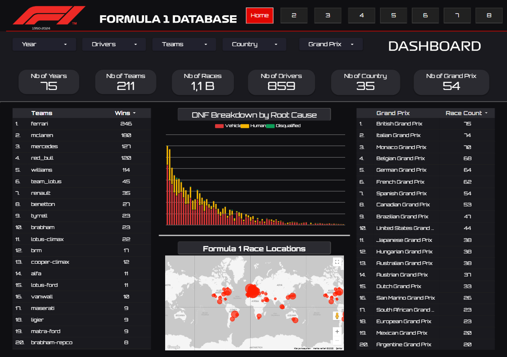

# 📘 **F1 Data Analysis Project**

## Portfolio context and project links

This is a team project presented in Hasan Emre İlhan's data analysis portfolio. The original team repository is maintained at [gunay-ozsoy/F1_Data_Analysis_Project](https://github.com/gunay-ozsoy/F1_Data_Analysis_Project). The notebooks and dashboard are team assets; this portfolio presentation does not assign sole authorship of every file to one contributor.

The recovery now rebuilds **all 20 named report sources** from a pinned upstream snapshot, covering recorded results through **7 July 2024**. Core data, season/career metrics, and timing/circuit metrics have independent review and 24 passing unit tests. The new indices are documented reconstructions and exploratory proxies; the original SQL formulas were unavailable.

**The dashboard remains partially recovered.** Four sources are connected in the owner's repair copy; 16 await migration. All 11 pages, filters, defaults, navigation and public viewer access still require validation. The overview map now shows circuit markers from exact coordinates. CSV connector permission is pending. A complete local model does not certify a working live dashboard. Use the repository and dataset links for a CV until all 11 pages pass viewer checks.

- [Rebuild instructions and methodology](./docs/RECOVERY_METHODOLOGY.md)
- [Observed dashboard status and remaining checks](./docs/DASHBOARD_RECOVERY.md)
- [Generated and live validation checkpoint](./data/recovery/report_validation.json)
- [Source dataset — Rohan Rao, Kaggle](https://www.kaggle.com/datasets/rohanrao/formula-1-world-championship-1950-2020)
- [Historical dashboard preview](./formula1_page_1.png)

The original project documentation follows unchanged below, including its historical dashboard links. Its prediction narrative and example have **not been revalidated** by this recovery. The screenshot is a preview, not proof of current live functionality.

---

# 🇬🇧 **F1 Data Analysis Project**

This project focuses on the analysis, cleaning, and visualization of a comprehensive Formula 1 dataset obtained from Kaggle.  
A total of 14 raw CSV files were processed to build a clean, analysis-ready data pipeline used for exploratory analysis, KPI modeling, machine learning, and dashboard creation.

---

## 🏎️ **Project Overview**

The primary objective of this project is to understand the multi-layered structure of Formula 1 data and build reliable models for analytics and prediction.  
The dataset includes:

- Driver details  
- Constructor (team) details  
- Race schedule  
- Circuit information  
- Race results  
- Sprint results  
- Qualifying sessions  
- Lap times  
- Pit stop records  
- Season summaries  
- Driver & constructor standings  
- Race status and DNF descriptions  

---

## 🧱 **Repository Structure**

```
F1_Data_Analysis_Project/
│
├── data/
│   ├── raw/                  
│   └── processed/            
│
├── notebooks/
│   ├── 01_data_exploration.ipynb      
│   ├── 02_data_cleaning.ipynb         
│   └── 03_F1_race_prediction.ipynb    
│
├── formula1_page_1.png   
└── README.md
```

---

## 🧪 **01 — Exploratory Data Analysis (EDA)**

Key steps performed:

- Structural inspection of all tables  
- Detection of missing values (`\N`)  
- Data type verification  
- Basic visual exploration (nationality distribution, races per year, grid vs finish trends)  
- Identification of required transformations for cleaning  

---

## 🧹 **02 — Data Cleaning**

Major transformations included:

- Converting `\N` → `NaN`  
- Fixing datetime formats  
- Numeric conversions  
- Removing irrelevant fields (such as URL fields)  
- Adding enriched features (e.g., `fullName`)  
- Merging race results with race status to include DNF details  
- Exporting all cleaned files as **clean_*.csv** into `data/processed/`

---

## 🧩 **03 — F1 Race Prediction Model**

The notebook **03_F1_race_prediction.ipynb** introduces a machine learning model designed to estimate the win probability of each driver before a race.

### 🔧 **Model Summary**
The model uses:

- Starting grid position  
- Team performance metrics  
- Driver historical statistics  
- Circuit-based tendencies  
- Season progression  

to produce a win probability prediction for upcoming races.

### 📈 **Example Prediction Output**

Based on data from the **2024 Season, Race 12**, the model generated the following **2025 Abu Dhabi GP predictions**:

| driver_name     | team_name | grid | win_probability |
|-----------------|-----------|------|-----------------|
| Lewis Hamilton  | Mercedes  | 2    | 48.5%           |
| George Russell  | Mercedes  | 1    | 45.0%           |
| Max Verstappen  | Red Bull  | 4    | 43.7%           |
| Lando Norris    | McLaren   | 3    | 36.4%           |
| Oscar Piastri   | McLaren   | 5    | 35.5%           |

**🏁 Model’s predicted favorite:** *Lewis Hamilton (Mercedes)*

This model will continue to evolve with additional features and improved training pipelines.

---

## 📊 **Dashboard (Looker Studio)**

This project includes a multi-page interactive dashboard built in Looker Studio.  
All KPIs and calculations were implemented using Looker Studio formulas and BigQuery logic.

Dashboard pages include:

- **Home Overview**  
- **Lap Performance**  
- **Excitement Analysis**  
- **Wins by Grid Position**  
- **Team & Driver Insights**  

Users can filter data by **year, driver, constructor, country, and Grand Prix**, enabling fully interactive exploration.

*A preview of the first dashboard page is shown below.  
These visuals represent only part of the full report — you can visit the Looker Studio link to explore the complete dashboard.*



### 🔗 **Looker Studio Dashboard Link**

👉 https://lookerstudio.google.com/s/uG-Xa6VAitw

---

## 🛠️ **Technologies Used**

- Python (pandas, numpy, matplotlib, seaborn)  
- Jupyter Notebook  
- Looker Studio  
- BigQuery    
- Virtual Environment (venv)

---

## 🚀 **Project Purpose**

This project aims to build an end-to-end data analysis and prediction pipeline while uncovering meaningful insights into the competitive ecosystem of Formula 1 racing.

---

---

# 🇹🇷 **F1 Veri Analizi Projesi**

Bu proje, Kaggle’dan elde edilen kapsamlı Formula 1 veri setinin analiz edilmesi, temizlenmesi, modelleme ve görselleştirilmesi üzerine kurulmuştur.  
14 adet ham CSV dosyası işlenerek analiz-hazır bir veri modeli oluşturulmuştur.

---

## 🏎️ **Proje İçeriği**

Projenin amacı, F1 verisinin karmaşık yapısını anlamak ve güvenilir analitik / tahmin modelleri geliştirmektir.  
Veri seti; sürücüler, takımlar, yarış takvimi, pistler, tur zamanları, pit stoplar, sıralamalar ve DNF açıklamalarını içerir.

---

## 🧱 **Klasör Yapısı**

```
F1_Data_Analysis_Project/
│
├── data/
│   ├── raw/            
│   └── processed/      
│
├── notebooks/
│   ├── 01_data_exploration.ipynb      
│   ├── 02_data_cleaning.ipynb         
│   └── 03_F1_race_prediction.ipynb    
│
├── formula1_page_1.png
└── README.md
```

---

## 🧪 **01 — Data Exploration (EDA)**

Bu aşamada:

- Tabloların yapısı incelendi  
- Eksik değerler tespit edildi  
- Kolon tipleri analiz edildi  
- İlk görselleştirmeler oluşturuldu  
- Temizlik aşaması için gereksinimler çıkarıldı  

---

## 🧹 **02 — Data Cleaning**

Başlıca yapılan işlemler:

- `\N` → `NaN` dönüşümü  
- Tarih kolonlarının formatlanması  
- Sayısal alanların düzenlenmesi  
- Gereksiz kolonların silinmesi  
- Yeni özelliklerin oluşturulması  
- Yarış sonuçlarının DNF açıklamalarıyla zenginleştirilmesi  
- Temiz verinin `clean_*.csv` formatında kaydedilmesi  

---

## 🧩 **03 — F1 Yarış Tahmin Modeli**

`03_F1_race_prediction.ipynb` notebook'u, yaklaşan yarışlar için sürücü galibiyet olasılıklarını hesaplayan bir makine öğrenimi modeli içermektedir.

### 🔧 **Model Özeti**
Model şu bilgileri kullanır:

- Grid pozisyonu  
- Takım performansı  
- Sürücü geçmiş başarıları  
- Pist eğilimleri  
- Sezonun ilerleyişi  

### 📈 **Örnek Çıktı**

**Baz alınan veri:** 2024 Sezonu, 12. Yarış  
**Tahmin edilen yarış:** 2025 Abu Dhabi GP

| driver_name     | team_name | grid | win_probability |
|-----------------|-----------|------|-----------------|
| Lewis Hamilton  | Mercedes  | 2    | 48.5%           |
| George Russell  | Mercedes  | 1    | 45.0%           |
| Max Verstappen  | Red Bull  | 4    | 43.7%           |
| Lando Norris    | McLaren   | 3    | 36.4%           |
| Oscar Piastri   | McLaren   | 5    | 35.5%           |

**🏁 Model Tahmini Favori:** *Lewis Hamilton (Mercedes)*

---

## 📊 **Dashboard (Looker Studio)**

Proje kapsamında Looker Studio üzerinde çok sayfalı interaktif bir dashboard oluşturulmuştur.  
Tüm hesaplamalar Looker Studio formülleri ve BigQuery üzerinde yapılmıştır.


🔗 Dashboard bağlantısı:  
👉 https://lookerstudio.google.com/s/uG-Xa6VAitw

---

## 🛠️ **Kullanılan Teknolojiler**

- Python  
- Jupyter Notebook  
- Looker Studio  
- BigQuery   
- venv

---

## 🚀 **Projenin Amacı**

Bu proje, uçtan uca bir veri analizi ve tahmin pipeline'ı kurarak F1 dünyasının rekabet dinamiklerini veri odaklı bir bakışla incelemeyi hedefler.
